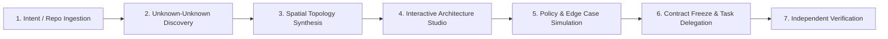

# ArchitectAI — Architecture Studio Blueprint

## 1. Executive Context & Vision

ArchitectAI is an engineering-intelligence platform for builders who describe product intent but need authoritative systems reasoning to uncover missing architectural concerns, enforce invariants, and delegate safe implementation to coding agents.

The **Architecture Studio** is the primary spatial reasoning surface of ArchitectAI. It transforms product requirements and discovered unknown-unknowns into an interactive, visually legible system architecture.

The core promise of the Studio is **comprehensibility without oversimplification**:
1. **Explainable topology**: Founders, product engineers, and senior architects can visually explore every component, boundary, and protocol.
2. **Deep engineering provenance**: Clicking any node or connection reveals why it exists, what failure modes it prevents, what trade-offs were made, and how independent verification will test it.
3. **Behavioral simulation**: Interactive simulations make invisible distributed systems hazards (such as window edge spikes, retry storms, and cache stampedes) tangible and educational before any code is generated.
4. **Direct contract traceability**: Every node, connection, and policy maps directly to canonical domain entities (`EngineeringContract`, `ArchitectureDecision`, `ContractInvariant`, and `VerificationPlan`). The Studio is a visual projection of the contract, never a separate or diverging source of truth.

---

## 2. User Journey



### Stage 1: Ingestion & Intent Decomposition
- **Greenfield**: User provides a raw requirement (e.g., *"Rate limit each API tenant to 100 requests per minute with burst tolerance"*).
- **Existing Repository**: User points to a Git repository. ArchitectAI inspects the working tree, package manifests, framework configuration, and data stores to extract the current baseline topology.

### Stage 2: Unknown-Unknown Discovery & L1/L2/L3 Grounding
- Reasoning identifies missing system dimensions:
  - L1: Concurrency, time windows, memory limits, network latency.
  - L2: Boundary burst amplification, sliding-window precision vs. Redis memory overhead, clock drift.
  - L3: Redis Sorted Sets (`ZADD`, `ZREMRANGEBYSCORE`) vs. Token Bucket with Lua script atomicity.

### Stage 3: Spatial Topology Synthesis
- ArchitectAI synthesizes a structured graph representation:
  - Ingress / Client perimeter
  - API Gateway / Edge proxy
  - Service Fleet / API instances
  - Distributed Cache / Coordination tier (Redis)
  - Persistent Datastore tier
- Nodes and edges receive strict semantic typing, metadata, and invariant links.

### Stage 4: Interactive Architecture Studio (The Active View)
- The user enters the Studio.
- They inspect the components, click to understand decisions, examine trade-offs, and inspect failure modes.

### Stage 5: Educational Simulation
- The user interacts with the simulation controls (e.g., toggling between **Fixed-Window Counter** and **Sliding-Window Log / Token Bucket**).
- Real-time animated requests travel along connections. The UI shows state accumulation, boundary burst failure, and how sliding-window smooths out traffic.
- Clearly marked: `EDUCATIONAL SIMULATION — NOT MEASURED PRODUCTION TELEMETRY`.

### Stage 6: Implementation Plan & Verification
- Once satisfied, the user proceeds to delegate implementation. The graph decisions translate into bounded tasks for coding agents (e.g. Codex) and automated adversarial tests for the verification engine.

---

## 3. Primary Screen Anatomy

The Architecture Studio desktop layout is structured into three clean, focused regions with zero layout overflow and clear vertical rhythm:

```
+---------------------------------------------------------------------------------------------------+
|  Studio Header Bar: Project Name | Active Requirement | Demo Tag | Sim Controls | Fit / Zoom       |
+-------------------+---------------------------------------------------------+---------------------+
|                   |                                                         |                     |
|  Left Navigation  |  Central Interactive Architecture Canvas                |  Contextual         |
|  & Project Scope  |                                                         |  Inspector          |
|                   |  - Ingress / Clients                                    |                     |
|  - Requirement    |  - Gateway / Reverse Proxy (Rate Limiting Layer)       |  - Selected Entity  |
|  - Components (5) |  - API Instances (Stateless Fleet)                      |  - Purpose & Role   |
|  - Flows (4)      |  - Distributed State (Redis 7+ Cluster)                |  - Why Selected     |
|  - Invariants (3) |  - Datastore (PostgreSQL / Relational)                  |  - Trade-offs       |
|  - Sim Mode       |                                                         |  - Failure Modes    |
|    Fixed vs Slide |  [ Animated Request Streams & State Counters ]          |  - Alternatives     |
|                   |                                                         |  - Verification Spec|
|                   |  Legend & Trust Boundary Overlays                       |                     |
+-------------------+---------------------------------------------------------+---------------------+
|  Status & Traceability Strip: Contract ID | Revision | Invariants Enforced (3/3) | Demo Mode       |
+---------------------------------------------------------------------------------------------------+
```

### 1. Studio Header Bar (Top)
- **Identity & Context**: ArchitectAI Studio icon, Project Name, and Requirement Title.
- **Demo / Environment Badge**: Crisp, non-intrusive `DEMO` badge distinguishing synthesized prototypes from verified deployments.
- **Global Actions**: Canvas Fit-to-Screen, Reset View, Export Architecture Diagram, and Proceed to Contract/Build.

### 2. Left Navigation: Scope & Simulation Control (Width: 260px)
- **Active Requirement Summary**: Concise statement of what is being architected.
- **Layer & Entity Filter**: Quick toggle to highlight Compute, State, Network, or Security boundaries.
- **Interactive Simulation Panel**:
  - Algorithm Selector: **Fixed-Window Counter** vs. **Sliding-Window Token Bucket**.
  - Traffic Stimulus: Low steady traffic, Bursty traffic, Boundary attack pattern (50 req at t=59s, 50 req at t=61s).
  - Rate-limit counter: live visual gauge showing allowed vs. rejected requests.
  - Disclaimer banner: `EDUCATIONAL SIMULATION`.

### 3. Central Interactive Architecture Canvas (Flexible Main Canvas)
- **Visual Presentation**: Restrained dark slate canvas (`#0b0f17` background with subtle grid coordinates `#161f2e`).
- **Nodes**: Clearly identifiable services, data stores, and ingress points with tier badges, protocol indicators, and live state tags.
- **Edges**: Directional SVG connection paths with animated request particle pulses (150–250ms smooth physics) showing data flow and rate-limit drops.
- **Trust Boundaries**: Subtle dashed boundaries delineating Untrusted Internet, DMZ / Ingress, Private VPC Compute, and State Infrastructure.
- **Direct Manipulation**: Pan, zoom, click to select, hover dependency spotlighting.

### 4. Contextual Right Inspector (Width: 380px)
- When a **Node** or **Connection** is clicked, the inspector dynamically displays:
  - **Entity Title & Architectural Role**: e.g., `Redis 7+ Distributed State Store (Sliding-Window Log)`.
  - **Why Selected**: Precise systems rationale (e.g., in-memory sub-millisecond atomic ZADD/ZRANGE operations prevent race conditions across multi-instance API servers).
  - **Trade-offs**: Latency vs. Memory overhead, operational complexity, eviction policies.
  - **Failure Modes & Defenses**: Cache exhaustion (OOM), hot tenant keys, split-brain, network partition fallback.
  - **Rejected Alternatives**: In-memory local Node.js Maps (fails multi-instance synchronization), relational SQL counters (excessive write lock contention).
  - **Implementation Specification**: Exact configuration keys, Lua script atomic boundaries, connection pooling constraints.
  - **Independent Verification Requirement**: The exact invariant test ArchitectAI will compile to prove the implementation works under adversarial load.

---

## 4. Diagram Interaction Model

### 1. Selection & Highlighting
- **Node Click**: Selects the node, activates the Right Inspector, and illuminates upstream/downstream connections (dimming unrelated components).
- **Edge Click**: Selects the connection, shows protocol attributes (HTTP/1.1, RESP3, TCP), payload characteristics, bandwidth constraints, and timeout/retry policies in the Inspector.
- **Canvas Click**: Clears selection, returns Inspector to the Architecture Overview & Contract Summary.

### 2. Keyboard Accessibility & Navigation
- `Tab` / `Shift+Tab`: Sequentially cycle focus through canvas nodes and controls.
- `Enter` / `Space`: Select the focused node and open its inspector details.
- `Escape`: Deselect node or dismiss mobile drawer.
- `Arrow Keys`: Pan canvas or navigate between adjacent nodes in flow direction.
- `+` / `-` / `0`: Zoom in, zoom out, fit to viewport.

### 3. Responsive & Mobile Adaptations (390x844 Mobile)
- Desktop-first layout with clean mobile adaptation:
- On mobile (`< 768px`):
  - Canvas fills the screen with touch pan/pinch-zoom enabled.
  - Left navigation collapses into a slide-over drawer accessible via top pill.
  - Right inspector becomes a bottom sheet drawer that glides up smoothly (200ms cubic-bezier) when a node is tapped, with drag-handle to collapse.
  - Zero horizontal document overflow (`overflow-x: hidden`).

---

## 5. Animation Principles & Sensory Craft

In accordance with our anti-slop frontend engineering standards:
1. **Restraint over spectacle**: No AI-purple nebula clouds, no floating particle mesh, no unnecessary continuous bounce loops.
2. **Motivated transitions**: Every animation communicates system state.
   - Request particles along edges visualize burst accumulation and rate limiting.
   - State badges flash amber/red only when an edge case (e.g., 200% burst threshold) is simulated.
3. **Transition timing**:
   - UI drawers, tabs, and panel reveals: strictly 150–250ms with `cubic-bezier(0.16, 1, 0.3, 1)`.
   - Edge request pulses: 1200ms ease-in-out cycle during simulation run, cleanly pauseable.
4. **Hardware Acceleration**:
   - Only `transform` and `opacity` are animated.
   - SVG paths use CSS stroke-dashoffset or hardware-accelerated transforms.
5. **Strict Reduced Motion**:
   - When `prefers-reduced-motion: reduce` is active:
     - Request particle animation is stopped.
     - State counters update instantly without transition delays.
     - Drawers open with an immediate opacity cut (0ms).

---

## 6. Evidence, Provenance & Engineering Rigor

ArchitectAI never presents model intuition as ungrounded truth. In the Architecture Studio:
- **L1 Fundamental Primitives**: Every node displays the durable systems primitives it addresses (Memory, Concurrency, Network Latency, State Consistency).
- **L2 Failure Patterns**: The Inspector surfaces the specific failure pattern prevented (e.g., *Boundary Burst Amplification*, *Token Refresh Race*, *Connection Pool Starvation*).
- **L3 Technology Facts**: Concrete versioned mechanisms (e.g., *Redis 7.2 Redis Enterprise / OSS Lua 5.1 atomic script*, *Node.js 20 event loop lag*).
- **Honest Uncertainty**: If a parameter depends on production traffic that cannot be inferred (e.g., *peak concurrent active tenants*), it is explicitly surfaced under *"Unresolved System Questions"* with a recommended default and rationale.

---

## 7. Entry Paths: Greenfield vs. Existing Repository

```
+------------------------------------------------------------------------------------+
| ENTRY PATH A: Greenfield Requirement                                               |
| User Intent -> Capability Decomposition -> Full Synthetic Topology Generated       |
| Everything marked as "Proposed Implementation" with complete contract.            |
+------------------------------------------------------------------------------------+
| ENTRY PATH B: Existing Git Repository                                              |
| Working Tree Ingestion -> Static AST & Package Scan -> Existing vs New Overlay    |
| Existing services rendered in muted neutral tone; new/modified components          |
| highlighted with accent borders and explicit change diff badges.                   |
+------------------------------------------------------------------------------------+
```

### Greenfield Path
- Generates the complete reference topology required to satisfy the functional and non-functional requirements.
- Recommends baseline infrastructure tiers (e.g. Ingress Gateway -> Service Node -> Redis -> Postgres).

### Existing Repository Path
- Analyzes existing code (e.g., Express/Fastify routes, database clients).
- Maps where rate limiting must be inserted:
  - If Redis is already in `package.json`, leverages existing connection infrastructure.
  - If no distributed store exists, flags the decision to introduce Redis vs. accept single-instance in-memory limitations, prompting user confirmation.
- Guarantees untouched files remain unhighlighted and isolated from implementation plans.

---

## 8. Single Source of Truth: Canonical Contract Mapping

The Architecture Studio **does NOT maintain a parallel schema or separate data store**. Graph entities map 1:1 with the canonical ArchitectAI domain model:

| Studio Visual Entity | Canonical Domain Entity (`@architectai/domain`) | Field / Mapping |
|---|---|---|
| **Graph Node** | `EngineeringContract.decisions` & `context.capabilities` | `ArchitectureDecision` id, title, chosenOption, rationale |
| **Trust Boundary** | `EngineeringContract.discoveredConcerns` | Concerns with L1 dimension `trust boundaries` or `resource ownership` |
| **Edge / Protocol** | `ContractInvariant` & `ArchitectureDecision` | Invariant target communication channel and constraints |
| **Why Selected** | `ArchitectureDecision.rationale` | Grounded justification referencing L1/L2/L3 knowledge items |
| **Trade-offs** | `ArchitectureDecision.tradeOffs` | Accepted liabilities and mitigations |
| **Failure Modes** | `DiscoveredConcern.description` & `evidence` | L2 Failure patterns linked to the invariant |
| **Alternatives** | `ArchitectureDecision.alternativesConsidered` | Options evaluated and reasons for rejection |
| **Verification Spec** | `ContractInvariant.verificationRequirements` | Executable invariant assertion (`operator`, `expected`, `strategy`) |
| **Implementation Task** | `ImplementationPlan.tasks` | Specific code modifications assigned to the coding agent |

---

## 9. Rate Limiting Demo Scenario Specifications

For this high-fidelity prototype, the Studio renders a canonical enterprise rate-limiting scenario:
- **Requirement**: *"Rate limit each authenticated tenant to 100 API requests per minute with burst tolerance up to 20 requests over limit, dropping abusive traffic with HTTP 429 without degrading API latency."*
- **Nodes**:
  1. `client-perimeter`: Multi-tenant Public Clients (Mobile Apps, Web SPAs, Partner APIs).
  2. `api-gateway`: Envoy / NGINX Ingress Edge Gateway with Rate-Limit Filter.
  3. `api-instances`: Stateless Node.js / TypeScript API Service Fleet (3 instances).
  4. `redis-cluster`: Redis 7+ Distributed Memory Cluster (Sliding-Window Log / Token Bucket).
  5. `postgres-db`: Primary Relational Database (Tenants, Quotas, Audit Logs).
- **Connections**:
  - `edge-to-gateway`: HTTPS / TLS 1.3 Ingress with Client IP & Bearer JWT.
  - `gateway-to-redis`: RESP3 Ultra-low latency atomic token-bucket check (<1ms SLA).
  - `gateway-to-api`: Reverse Proxy HTTP/2 Internal VPC routing.
  - `api-to-postgres`: Connection-pooled SQL queries for tenant entitlement cache warming.
- **Interactive Simulation**:
  - **Mode A (Fixed Window)**: Shows 50 requests hitting at `t=0:59` and 50 requests hitting at `t=1:01`. Demonstrates how fixed window permits 100 requests in 2 seconds (200% burst), starving downstream instances.
  - **Mode B (Sliding Window Log / Token Bucket)**: Demonstrates continuous time-slice smoothing. Requests exceeding quota receive immediate HTTP 429 `Retry-After: 58` at the gateway, shielding API instances and the database.

---

## 10. Summary & Sign-off

This blueprint establishes the strict boundary between the visual reasoning of the Architecture Studio and the underlying deterministic engineering contracts. Coding the prototype will strictly implement this specification without introducing secondary state stores or mock inaccuracies.
